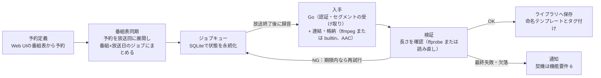

# rajikura（ラジクラ）要件定義

rajikura が何をし、何をしないかの要件。用語は [GLOSSARY.md](../GLOSSARY.md) に従う。設計の決定の理由は [ADR（docs/adr/）](adr/) にある。

- [背景と目的](#背景と目的)
- [スコープ](#スコープ)
- [機能要件](#機能要件)
- [非機能要件](#非機能要件)
- [アーキテクチャ概要](#アーキテクチャ概要)
- [未確認の事項](#未確認の事項)

## 背景と目的

radiko の放送を、録れるまで再試行して録り、ライブラリへ自動で保存する常時稼働のサービス。放送済みの放送回はタイムフリーから録音し、タイムフリーの対象外の放送回は放送中にライブで録る（ライブ録音は再試行しない）。Jellyfin などのライブラリへ命名テンプレートとタグ付きで保存する。 <!-- 足したら直す: 録音の方式 -->

- 録音用の PC を常時起動しておかなくてよいように、コンテナ・Linux・Windows で常時稼働する
- 7 日間（会員種別によっては 30 日間）の録音期限内なら、録れるまで再試行する
- 番組表のメタデータで、録音時にフォルダとファイル名の配置まで済ませる
- 予約を DB に一元化し、番組表から放送回へ自動で展開する
- 録音の成否を、長さの検証と失敗の通知で知らせる

## スコープ

最優先は radiko タイムフリーによる、毎週の放送の録音。タイムフリーの対象外の放送回は、radiko のライブのストリームから放送中に録る（ライブ録音。[ADR 0022](adr/0022-live-recording-for-timefree-excluded-airings.md)）。らじる★らじる聴き逃しは作らない（HLS の AES-128 を解く複製は、私的複製の例外から外れるおそれがあるため。[ADR 0028](adr/0028-publish-as-oss-under-radiko-terms.md)）。録音は Go の自前実装で行う（[ADR 0001](adr/0001-native-go-fetcher-over-yt-dlp.md)）。radiko の規約の第 4 条を承知のうえで、ソースを公開した OSS（MIT）として、使う人が自分の環境で動かせる形で配る（[ADR 0028](adr/0028-publish-as-oss-under-radiko-terms.md)）。

**やること** <!-- 足したら直す: 録音の方式 -->

- radiko タイムフリーの録音（録音は Go の自前実装。[ADR 0001](adr/0001-native-go-fetcher-over-yt-dlp.md)。会員種別は非会員・エリアフリー・タイムフリー30・ダブルプランの 4 種に対応する設計。今動かすのは非会員だけ）
- radiko のライブ録音（タイムフリーの対象外の放送回だけ）
- 毎週の放送を毎週の予約で指定した自動録音（録るものは番組 × 放送日のジョブ単位。ジョブの単位と分割番組の連結は [ADR 0003](adr/0003-job-per-show-and-broadcast-day.md)）
- Web UI の番組表から放送回を選んで予約（1 回・毎週）
- Web UI での番組とジョブの管理（ログイン認証あり）
- 保存先フォルダへの保存とタグ付け（命名テンプレートと、Jellyfin などのプリセット）
- タイムフリーから録るファイルへの、radiko のチャプターの埋め込み（タイムフリーからの録音は遅らせずに録り、保存のときに取る。取れなければチャプター無しで保存し、まだできていないだけかもしれないものは、チャプターの取り直しで後から入れる。設定で切れる。[ADR 0027](adr/0027-chapters-refetched-by-rerecording.md)）
- 録音の成否の検証と通知

**やらないこと**

- 録音の再生プレイヤー（本格的な再生はメディアサーバーや各種プレーヤーに任せる。Web UI のジョブの詳細には、録れたかを確かめるための最小の再生だけを持つ。続きから再生・聴いた印・再生速度の操作は持たず、ブラウザの `<audio controls>` の機能（再生・シーク・音量）だけ）
- 音泉、NHK ゴガク、サウンドキャプチャーなど、radiko 以外のサービスの細かな対応先
- mp3 などへの再エンコード（配信の AAC のまま保存）
- 他人が自分のサーバーを使うマルチユーザー運用（各自が自分の環境で動かす前提）
- 位置情報やエリアの偽装によるエリア外の局の録音（エリア外の局は、エリアフリー会員の正規のログインでだけ取る）
- 営利（広告・ライセンスの販売・カンパ。始めるなら弁護士への相談を前提に決め直す。[ADR 0028](adr/0028-publish-as-oss-under-radiko-terms.md)）
- 暗号を解く録音（らじる★らじる聴き逃しの HLS の AES-128。[ADR 0028](adr/0028-publish-as-oss-under-radiko-terms.md)）
- チャプターの、Jellyfin の画面での表示（Jellyfin は音楽ライブラリのチャプターを保存しない）、ライブ録音のファイルへの埋め込み（[ADR 0027](adr/0027-chapters-refetched-by-rerecording.md)）

## 機能要件

中心は「予約 → 放送回 → ジョブ」の流れで、録音は放送後に行い、期限内なら成功するまで再試行する（タイムフリーの対象外の放送回は、放送中にライブ録音で録り、録音は自動では再試行しない。録れた分を保存できなかったときは、保存だけを自動でやり直す）。ジョブは番組 × 放送日の単位で、分割番組は連結して 1 ファイルにする（[ADR 0003](adr/0003-job-per-show-and-broadcast-day.md)）。連結するのは、分割番組でパートをつなぐ番組だけ（[ADR 0003](adr/0003-job-per-show-and-broadcast-day.md)）。 <!-- 足したら直す: 録音の方式 -->

1. **予約管理**
   - 「放送局 + 曜日 + 開始時刻」（毎週の予約）で、毎週録る放送回を定義する
   - 毎週の予約は、任意の開始日（放送日）を持てる。開始日より前の放送日の放送回には当たらない（空なら制限なし）。番組表の「毎週録音」は、その放送回の放送日を開始日に入れる。API は `weekly` の `from` で、番組の編集画面で空にも書き換えもできる
   - 毎週の予約は、任意の終了日（放送日）も持てる。終了日より後の放送日の放送回には当たらない（終了日の放送日の放送回には当たる。空なら制限なし）。終了日が開始日より前なら断る（同じ日はよい）。API は `weekly` の `until` で、番組の編集画面で空にも書き換えもできる。番組表の「毎週録音」は終了日を入れない。同じ枠で番組が切り替わるとき、古い番組の予約に終了日、新しい番組の予約に開始日を付けておけば、矛盾にならずに両方の放送回が録られる。終了日を過ぎた毎週の予約は消さずに残し、番組も無効にせず、通知もしない（[ADR 0029](adr/0029-weekly-until-over-title-based-handover.md)）
   - 予約は DB に保存し、Web UI から作成・編集・削除する（スクリプトや AI は API トークンで API を呼ぶ。TOML による受け渡しは無い。[ADR 0017](adr/0017-backup-by-db-copy.md)）
   - 予約は番組に属し、1 つの番組は複数の予約を持てる。ライブラリ上の表示名は番組ごとに指定できる
2. **番組表の同期と放送回の展開**
   - radiko の週間番組表を定期的に引く
   - 予約に一致する放送回を、番組 × 放送日のジョブにまとめてジョブキューに登録する
   - 放送時間の変更、特番による休止に追従する（休止回はジョブに含めない）
   - 毎週の予約の枠に放送回が無い放送日（当たらない日。今日から 7 日先まで）は、その時刻を含む放送回と、番組名の合う放送回（番組名が番組の `name` で始まるもの）とともに、番組の一覧で見せ、新しく見つけたら通知する。理由（休止・特番・前の放送回の延長・時刻の変更）は見分けない。別の時刻の放送回を自動では録らない
   - 開始日を持たない毎週の予約は、今日から先の放送日にだけ当たる。今日より前の放送日では、その予約からジョブを新しく作らず、作り直しもしない（その日にほかのジョブがあっても）。すでにある録音予定のジョブはそのまま録音する。放送回の開始時刻は後からずれない前提。放送済みの放送回を録りたければ、1 回の予約で足す
   - 開始日を持つ毎週の予約は、今日より前でも開始日からの放送日の放送回に当たり、録音期限の内側の放送回は録る（番組表の過去の放送回から「毎週録音」したとき、無効から有効に戻したときも）（[ADR 0018](adr/0018-weekly-from-reaches-past-days.md)）
   - 毎週の予約だけに当たる放送回で、番組表の番組名が番組の `name` で始まらない放送回（番組の `check_title` が立っているとき）は、どの放送日でも録らない（ジョブを `skipped` にして録りにいかない）。いつもと同じ開始時刻で始まる特番を録らないため。放送の前は録らない予定として番組表の同期のたびに決め直し、番組名が直れば録音予定に戻す。録りにいく時刻（放送の後）に番組表を取り直して確定し、録らなかったにする。番組表を取り直せなければ確定を待ち、番組表が取れた展開か録音期限で確定する。今日より前の放送回は、はじめから録らなかったにする。録らない予定にした・録音予定に戻した・録らなかったにしたときは通知する。1 回の予約の放送回は番組名を確かめずに録る（[ADR 0018](adr/0018-weekly-from-reaches-past-days.md)・[ADR 0019](adr/0019-skip-by-title-and-by-person.md)）
   - 人はジョブ単位で「録らない」（録音予定を録らない予定・録らなかったにする）と「録る」（録らない予定を録音予定に戻す、録らなかったを手動再試行する）を選べる（番組表の詳細・ジョブの画面・API・CLI）。人が決めたものは、その後の番組表の同期で番組名によって覆さない（休止・番組の無効化・番組表の終了時刻などの変化は効く）。人の操作では通知しない（[ADR 0019](adr/0019-skip-by-title-and-by-person.md)）
   - 1 回の予約は、その放送回のジョブが録音済みになったら消す（取れた分だけを保存したときも）。録音済みにならないまま録音期限を過ぎたものは、番組表の同期のときに消す
3. **録音**
   - 放送終了から一定時間後に、Go の自前実装でタイムフリーの音声を入手する（認証と、5 分ずつのチャンクのプレイリストの読み込み、ADTS セグメントの受け取りとつなぎ。詳細は [ADR 0001](adr/0001-native-go-fetcher-over-yt-dlp.md)）
   - AAC のまま m4a に格納する（再エンコードしない）。分割番組は放送回を開始時刻の順に連結して 1 ファイルにする。格納は ffmpeg で行うか、rajikura の中（builtin）で行うかを設定 `muxer` で選ぶ（既定は builtin。[ADR 0013](adr/0013-builtin-m4a-muxer.md)）
   - 失敗時は間隔を空けて再試行し、録音期限まで続ける（タイムフリーからの録音）。期限は会員種別で変える（非会員・エリアフリーは放送後7日、タイムフリー30・ダブルプランは30日。タイムフリー30の対象外の放送回は7日）。日数は、放送回の終了時刻が属する放送日の終わり（翌 05:00）から数える（タイムフリーは、この時刻で聴けなくなる）。非会員は聴取制限（再生開始から24時間・合計3時間）を考慮し、再試行回数を控えめにする
   - サーバーが停止していた間の未録音分は、復帰後に自動で回収する（タイムフリーからの録音。ライブ録音は放送中にしか録れない）
   - ジョブの放送回の 1 つでもタイムフリーの対象外なら、そのジョブの放送回を全部、ライブ録音で録る（[ADR 0022](adr/0022-live-recording-for-timefree-excluded-airings.md)）。方式は自動で決め、番組や予約に選ばせない
     - タイムフリーの録音とは別の録音役が、放送の開始の 1 分前から radiko のライブのストリームに繋ぎ、セグメントの時刻で放送回の開始から終了までを録る（同時に 8 本まで）
     - 切れたら繋ぎ直し、遡れる範囲で埋める。埋められなかった区間は欠落として録れた分を保存する
     - 録音の自動の再試行は無く、録音期限は放送の終了の 5 分後。放送の時刻に `serve` が動いていないと録れない
     - 録れた分を保存できなかったときは、録れた分を残して保存だけを、録音期限を過ぎても放送の終了から 24 時間まで自動でやり直す。それでも保存できなければ録音できなかったにして、録れた分を 30 日の間残す（その間は人の手動再試行で保存からやり直せる）
     - 長さが `#EXTINF` の合計とずれていても、取り直せないので検証の失敗にせずに保存し、通知に書く
     - 細部は [recording.md の「ライブ録音」](recording.md#ライブ録音)
4. **検証**
   - 格納した m4a の長さを測り（ffmpeg で格納したなら ffprobe で、builtin なら m4a を読み直して）、配信元が示す長さ（全セグメントの `#EXTINF` の合計）との差が10秒以内か確認する。番組表上の放送時間との比較は、大きなずれを見つける補助チェックにとどめる
   - 範囲外なら失敗として再試行する（ライブ録音は取り直せないので、失敗にせずにずれたまま保存し、通知に書く）
5. **保存とタグ付け**
   - 保存先フォルダに、命名テンプレート（例：`{番組の名前}/{放送日} {番組の名前}.m4a`）どおりのフォルダ構成とファイル名で保存する
   - よく使う構成をプリセットとして用意する。今あるのは Jellyfin（[ADR 0002](adr/0002-jellyfin-preset-layout.md)）だけ
   - 番組名、放送局、放送日、出演者、放送回の説明を m4a の標準タグに書き込む（特定の再生ソフトに依存しない）
   - 放送回の画像（radiko の番組表の `img`、連結したジョブでは先頭の放送回のもの）を付ける。番組のフォルダの `folder.jpg`（保存のたびに最新の画像で上書き）と、m4a のカバー画像（保存した時点の画像）の両方（連結したときの artist・comment は保存する放送回からつなぐ。[shows.md の「artist・comment・カバー画像」](shows.md#artistcommentカバー画像)）
   - 受け付ける画像は、JPEG・PNG・GIF で、受け取った大きさが 5 MB 以下、幅・高さが 4096 ピクセル以下のものだけ。PNG と GIF は JPEG に直して付ける（GIF は先頭のコマ、不透明でない画素は白の背景に重ねる）
   - 画像が手に入らないとき（URL が空、画像の読み込みの失敗、受け付けない形式、読み込めない中身、大きすぎる、幅か高さが 4096 ピクセルを超える）は画像なしで保存する（保存は失敗にしない。ログに警告を出すだけで通知はしない）
   - 任意で、保存後に Jellyfin の API を呼んでライブラリを再スキャンさせる
6. **通知と可視化**
   - 通知はまず DB に 1 件ずつ書き（Web UI の履歴の元）、通知先（Discord。差し替え可能な設計にする。選ばないこともできる）には別に送る。作ってから 1 時間を過ぎた通知を送ろうとして送れなければ、諦めて「送れなかった」の印を付ける（[ADR 0011](adr/0011-notifications-written-to-db-then-delivered.md)）
   - 次の契機で、起きるたびに通知する（日次のまとめは送らない。[ADR 0010](adr/0010-per-event-notifications-and-metrics.md)） <!-- 足したら直す: 通知の種類 -->
     - ジョブの出来事: 録音済み（保存した）・欠落ありで保存した（ライブ録音では欠けた長さも書く）・録音できなかった（ジョブが `expired` になった）・録らない予定にした（放送の前に、番組名が食い違うので録音予定を録らない予定にした）・録音予定に戻した（放送の前に、番組名が直ったので録らない予定を録音予定に戻した）・録らなかった（番組名が食い違うので、今日より前の放送回でジョブを `skipped` で作った、または録りにいく時刻に録音予定を録らなかったにした。ジョブにつき 1 回）・期限間近（録音期限の 24 時間前に、まだ録音を終えていないジョブ。ジョブにつき 1 回。ライブ録音のジョブには送らない）。録音済みと録音できなかったの通知には、番組表の番組名が番組の `name` と食い違っていれば添える。人が録り直したジョブは、録れたら録音済み（欠落あり）、録れなければ録音できなかったをもう一度送る（受け付けたこと自体は送らない）
     - キーワードの出来事: キーワードに当たった放送回を録音予定にした（足すたびに 1 回。分割番組のパートをまとめて足したときも 1 回）・上限で足すのを止めた（上限に達して足さなかったときに 1 回だけ。上限を下回ってから、また達したら、もう一度）。録音済みの通知を止める設定では止めない
     - 番組の出来事: 毎週の予約の当たらない日を新しく見つけた（番組表の同期 1 回・番組ごとに 1 通にまとめる。当たらない日ごとに 1 回だけで、直ってからまた当たらなくなっても送り直さない）。録音済みの通知を止める設定では止めない
     - サービスの異常: 番組表の同期が 2 回続けて失敗した・radiko がエリア外と判定した・自動のバックアップを取れなかった・ライブ録音の前にスリープ中の PC を起こせない見込み（Windows）・ライブラリの再スキャンを頼めなかった。その復旧も通知する。異常が続いている間は始まりを送り直さない（再起動しても） <!-- 足したら直す: サービスの異常 -->
   - 録音済みの通知だけは、通知先に送らないようにできる（DB には書く）。再試行待ちは通知しない
   - サービスが動いていることは、通知ではなく `/metrics`（最後に保存した時刻・通知を送れなかった数）を外から見て確かめる
7. **Web UI：番組表**
   - 放送局 × 時間のグリッドで、放送日を切り替えて番組表を表示する（過去は会員種別の録音期限まで（7 日または 30 日）、未来は 7 日）。局は、radiko が判定した自分のエリアの全局を出す。PC では局 × 時間のグリッド、スマホでは局を 1 つ選んで時刻順のリストにする
   - 番組表は DB に貯めず、radiko のエリアの日別番組表をその都度引いて、しばらくキャッシュする
   - 番組名・出演者・説明で語を探せる（空白で区切った語の AND。表示する範囲の番組表から探す）
   - キーワード（画面では「キーワードで録音」。用語集の「キーワード」、[ADR 0014](adr/0014-keyword-adds-onces-to-shows.md)）: 出演者名などの語（空白で区切った語の AND。番組名・出演者・説明を見る）と、任意の除外する語・局で番組表を探し、当たったまだ始まっていない放送回（今日から 7 日先までの放送日）を、1 回の予約として自動で足す。画面はナビの「キーワード」
     - 足す決め方は番組表の「この回を録音」と同じ。番組名から末尾の印を落とした名前の番組に足す（その名前の番組が無ければ作る）。分割番組なら、自動の組（用語集）で同じ放送日のパートもまとめて足す。作る番組は、同じ放送日に 2 つ以上の放送回を当てるなら分割番組でつなぐ番組にする <!-- glossary-ok: 回 -->
     - 当てるのは番組表の同期のときと、キーワードを作った・変えた直後。足した後は人が足した 1 回の予約と同じに扱い、人が消した放送回は足し直さない
     - 足す先が無効な番組・ほかの番組や足す先の番組がもう当てている放送回は飛ばす（タイムフリーの対象外の放送回は飛ばさず、ライブ録音で録る）
     - 広すぎるキーワードで録音が際限なく増えないように、キーワードごとに、足した放送回のうちまだ録音を終えていないものの数に上限（既定 10）を設ける
   - 放送回を選ぶと詳細（説明・出演者）を表示する（PC では番組表を隠さない右側の欄、スマホでは画面いっぱい）。「この回を録音」（1 回の予約）「毎週録音」（毎週の予約）を押すと、選んだ放送回をすぐ予約する <!-- glossary-ok: 回 -->
   - 分割番組のパートは、まとめて予約できる。予約なしの放送回を押すと、分割番組のパートの自動の組（用語集。同じ局・同じ放送日で番組名の末尾の印を落とすと番組名が同じになる放送回の中に、末尾に印のある放送回が 1 つでもあれば集めたもの。予約済みの放送回は除く）が選ばれ、Ctrl+Click・Shift+Click（タッチでは「ほかの回も選ぶ」）で選ぶ放送回を足す・外せる（同じ局・同じ放送日の予約なしの放送回だけ） <!-- glossary-ok: 回 -->
   - 足す先の番組は、選んだ放送回の番組名から決まる名前（1 件なら末尾の印を落とした名前、2 件以上なら共通の頭）の番組（無ければその名前で作る）で、1 回の予約もその番組に属させる。「設定を変えて予約」の折りたたみで選び直せる（既存の番組を選ぶか、名前を付けて新しく作る）。足す先の番組が無効な番組なら、すぐには予約せずに知らせる
   - 足した後にその番組が同じ放送日に 2 つ以上の放送回を当てるなら、「パートを 1 つのファイルにつなぐ」（既定でオン。分割番組でない既存の番組なら、オンで分割番組の設定をつなぐに変える）を選べる。タイムフリーの対象外の放送回も同じく予約でき、ライブ録音で録る
   - 予約した後は、何をしたか（番組を作ったか、既存の番組に足したか）を番組表の上の帯で知らせ、その知らせが出ている間は取り消せる。1 回の予約で当たっている放送回は詳細から録音をやめられ、毎週の予約で当たっている放送回は詳細から番組の設定を開ける
   - 録音予定・録音済み・録音できなかった放送回は番組表上で色分けする。タイムフリーの対象外の放送回は「ライブで録る」と出す
   - 放送済みで録音期限内の放送回も、その場で予約して録音できる（タイムフリーの対象外の放送回の録音期限は放送の終了の 5 分後なので、それを過ぎた対象外の放送回は予約できない）
   - PC のグリッドでは、出す局を絞り込める。隠した局はブラウザに覚える
8. **Web UI：番組管理**
   - 画面の言葉は、用語集の言葉（`GLOSSARY.md`）に揃える。録るもののまとまりは「番組」、どの放送回を録るかの決まりは「予約」（種類は「毎週」と「1 回」）と呼ぶ。英語のキー名（`split`・`check_title`）は画面に出さない
   - ナビは「番組表」「番組」「キーワード」「ジョブ」「通知」「設定」「API トークン」の順で、最初に開くのは番組表
   - 番組の一覧（ナビの「番組」）：番組ごとの有効／無効の切り替え、番組と予約の作成・編集・削除、次回の放送予定日時の表示
   - 番組の編集画面で、その番組の 1 回の予約の一覧を見て、消せる
   - 番組を作る・変えると、次の番組表の同期を待たずにジョブに反映する
   - ジョブ一覧：状態（`waiting` 録音予定・`running` 録音中・`retrying` 録音予定（失敗・再試行待ち）・`done` 録音済み・`expired` 録音できなかった（期限切れ）・`skipped` 録らない予定・録らなかった）で絞り込み。`skipped` は、確定の前を録らない予定、確定した後を録らなかったと出し分ける。状態の言葉は画面と用語集で同じ <!-- 足したら直す: ジョブの状態の移り方 -->
   - 失敗ジョブの手動再試行（手動再試行は、Web UI より前に CLI の `rajikura retry` で使える）
   - 録音済みのジョブの録り直し（ジョブの画面の詳細の「録り直す」・API・CLI の `rajikura rerecord`。保存したファイルが壊れていた・消してしまった、録れた音がおかしかったときに使う。[ADR 0025](adr/0025-rerecord-done-job-separately-from-manual-retry.md)）。手動再試行とは別の操作で、押すと確かめの画面を出す。タイムフリーから録ったもので、録音期限の内側のものだけを受け付け、ライブ録音のジョブ（放送は一度きり）と録音期限を過ぎたジョブは理由を添えて断る。radiko から取り直し、前に保存したファイルと同じ名前で保存するときは上書きする（録れなければ、録音期限までに一部の放送回しか取れなかったときも含めて、前のファイルを残す）。受け付けたこと自体は通知せず、録れたか録れなかったかをもう一度通知する。保存先のファイルが消えたことを rajikura が自分で見つけて録り直すことはしない <!-- 足したら直す: ジョブの状態の移り方 -->
   - 完了ジョブから、ファイルの保存先や長さなどの結果を確認できる

## 非機能要件

| 区分 | 要件 |
| --- | --- |
| 稼働環境 | コンテナ・Linux・Windows で常時稼働する。コンテナ基盤に載せられ、ライブラリはネットワーク越しの共有に書ける（[ADR 0005](adr/0005-run-in-container-with-network-share-library.md)）。コンテナイメージとネイティブバイナリの両方を作る。既定の `muxer = "builtin"` は ffmpeg / ffprobe を使わず、コンテナイメージにも入れていない（`muxer = "ffmpeg"` を選ぶときだけ外部ツールとして使う）。 |
| クロスプラットフォーム | コンテナイメージを主な配布形態としつつ、Linux / Windows 向けのネイティブバイナリも Release に付ける。macOS のネイティブバイナリと launchd、Linux の systemd は持たない。常駐方法は、Windows ではサービスを持つ。Windows は、仮想アカウント（`NT SERVICE\rajikura`）のサービスとして `rajikura service install` で入れ、`127.0.0.1` で待ち受ける（[ADR 0020](adr/0020-windows-service-with-virtual-account.md)、手順は [windows.md](windows.md)）。Windows の `rajikura.exe` はトレイ（`rajikura-tray.exe`）を埋め込み、`service install` が書き出して、打ったユーザーのログイン時に起動するよう登録する（[ADR 0023](adr/0023-windows-tray-embedded-and-linked-by-loopback.md)）。`serve` を Windows の外（コンテナなど）で動かすときは、`rajikura tray install -url` でトレイだけを入れ、その `serve` に向ける。Linux のバイナリとコンテナイメージにはトレイは入らない |
| 実装 | バックエンドは Go。radiko の認証と音声の録音は Go の自前実装で行い、メディア処理（連結・格納・長さの測定）は ffmpeg / ffprobe を外部プロセスとして呼ぶか、rajikura の中（builtin、github.com/abema/go-mp4 で箱を書く）で行う。既定は builtin で、ffmpeg を使わない（ffmpeg 版は選べるまま残してある。[ADR 0013](adr/0013-builtin-m4a-muxer.md)）。SQLite は cgo 不要のドライバを使い、クロスコンパイルを容易にする |
| 外部ツールの管理 | ffmpeg / ffprobe のパスは設定で指定できる。初回起動時に自動で取ってくる機能は作らず、builtin で ffmpeg を要らなくする（[ADR 0013](adr/0013-builtin-m4a-muxer.md)） |
| Web UI | Go の HTTP サーバーが JSON API を提供し、TypeScript + React の SPA をビルドして go:embed でバイナリに同梱する。PC とスマホのブラウザで使える |
| CLI | `rajikura` の `jobs`・`retry`・`skip`・`record`・`rerecord`・`backup` は DB を開かず、`serve` の HTTP API を API トークンで呼ぶ（手元のマシンや AI からリモートで使える）。DB に書くのは `serve` だけ。`version` と `licenses`（埋め込んだ依存のライセンスの一覧を出す）は手元で動く（[ADR 0009](adr/0009-cli-over-http.md)）。`service`（Windows だけ）も API を呼ばず、手元の PC に `serve` を Windows のサービスとして入れる・消す（[ADR 0020](adr/0020-windows-service-with-virtual-account.md)）。あわせて、`rajikura.exe` に埋め込んだトレイを入れる・消す（`install` は最後にトレイを起動する。[ADR 0023](adr/0023-windows-tray-embedded-and-linked-by-loopback.md)）。`tray`（Windows だけ）も API を呼ばず、`serve` を Windows のサービスにしていない PC（`serve` をコンテナなどで動かしている人）に、トレイだけを入れる・消す（`tray install -url` でリモートの `serve` に向ける）。Web UI のパスワードは、初めて Web UI を開いた人がセットアップコードを入れて決める（[ADR 0016](adr/0016-first-password-by-setup-code.md)）。設定は DB に置き、Web UI か `serve` の API で変える（TOML による設定・番組の受け渡しは無い。[ADR 0017](adr/0017-backup-by-db-copy.md)）。`serve` の起動の設定はフラグ `-data`（データのフォルダ）と `-listen` と `-allowed-hosts`（Web UI・API を名前で開くときの名前。[ADR 0021](adr/0021-web-ui-origin-host-and-login-limit.md)）だけで、設定ファイルは無い（[ADR 0015](adr/0015-settings-and-secrets-in-db.md)） <!-- 足したら直す: CLI のサブコマンド --> <!-- 足したら直す: service の操作 --> |
| 認証 | Web UI にログイン認証を付ける。radiko プレミアムのログイン情報は暗号化して保存する |
| アクセス | LAN と、Tailscale などの VPN の内側だけで使う。インターネットには公開しない |
| ネットワーク | radiko のエリア判定のため、使う人自身のエリアの回線から接続する。VPN の出口ノードは使わない |
| 時刻 | 番組表はすべて日本時間で扱う（タイムゾーンは Asia/Tokyo を明示） |
| 信頼性 | 停止・再起動・スリープから復帰しても、ジョブ状態は DB に残り、未完了分から再開する。子プロセスは本体の終了時に確実に止める。DB を失ったときに戻せるように、`serve` を止めずに DB の写し（バックアップ）を取れる（API の `GET /api/backup`、CLI の `rajikura backup`、Web UI の設定の画面の「ダウンロード」）。人が取らなくても、設定 `backup_dir` があれば `serve` が 1 時間ごとに見て、前に取れてから 24 時間が過ぎていれば取り、新しいものから `backup_keep` 個を残す。取れなければサービスの異常として通知し、`backup_dir` が空の間は Web UI の帯で知らせる。バックアップはログインのセッションと秘密の鍵を含まない。戻すのは `serve` を止めて DB を置き換える手順だけで、戻す API・画面は作らない（[ADR 0017](adr/0017-backup-by-db-copy.md)） | <!-- glossary-ok: ダウンロード -->
| 保守性 | 録音部分は差し替え可能に抽象化する。radiko 側の変更（ホストの移行など）への追随の時期は約束しない（README・CONTRIBUTING と同じ） |
| 更新 | radiko 側の仕様変更に追随して録音部分を直す |
| 設定 | エリアや会員種別、通知先、保存先、命名テンプレートは設定で切り替えられる。設定は DB に置いて Web UI で変え、設定ファイルを手で書かずに始められる。保存した設定は再起動しなくても効き（番組表のキャッシュの大きさを除く）、秘密は DB の中で暗号化する（[ADR 0015](adr/0015-settings-and-secrets-in-db.md)）。ファイル名は Windows で使えない文字も考慮して整形する。README に私的利用に限る旨を明記する |
| 利用範囲 | 個人の私的利用に限る。録音した音声データを共有・再配布しない |

## アーキテクチャ概要

単一の Go デーモンが SQLite のジョブキューを定期的に走査し、放送が終わった未録音のジョブを録りに行く。タイムフリーの対象外の放送回を持つジョブは、別の録音役が放送中にライブで録る（下の図はタイムフリーからの録音の流れ）。

ジョブの状態は `waiting`（放送待ち）→ `running`（録音中）→ `done`（完了）と進み、録音または検証が失敗したら `retrying`（再試行待ち）になって、録音期限まで再試行する。録音期限を過ぎたものは `expired` として通知する。毎週の予約だけに当たり番組名が食い違うものは、展開がジョブを `skipped` にし、録りにいかない（放送の前は録らない予定で、番組名が直れば `waiting` に戻す。録りにいく時刻に確定して録らなかったになる）。人も `waiting` のジョブを「録らない」で `skipped` にでき、「録る」で録らない予定を `waiting` に戻せる。`retrying` / `expired` / 確定した `skipped` のジョブは、人が手動再試行（`rajikura retry`）で `retrying` に戻せる（録音期限の内側に限る。ライブ録音で録れた分を残している間は、録音期限を過ぎていても戻せる）。タイムフリーから録った `done` のジョブは、人が録り直し（`rajikura rerecord`）で `retrying` に戻せる（録音期限の内側に限る。[ADR 0025](adr/0025-rerecord-done-job-separately-from-manual-retry.md)）。チャプターが取れなかった `done` のジョブは、チャプターができたら rajikura がチャプターの取り直しで `retrying` にし、録れなければ `expired` にせずに `done` に戻す（[ADR 0027](adr/0027-chapters-refetched-by-rerecording.md)）。ライブ録音のジョブは `waiting` → `running`（放送の開始の 1 分前）→ `done` / `expired` と進み、録音そのものは再試行しない（録音期限は放送の終了の 5 分後）。rajikura が `retrying` にするのは、録れた分を保存できなかったときだけで、保存だけを放送の終了から 24 時間までやり直す。 <!-- 足したら直す: ジョブの状態の移り方 -->

## 未確認の事項

- タイムフリー30 で 8 日目以降の放送回が録れるか（会員として録音するときに確かめる）
- 非会員が radiko のライブに同時に 9 本以上繋げるか、3 分より長く繋いだときに同時接続の上限やセッション・トークンの切れが出るか（ライブ録音。非会員の 1 回の認証で 8 本まで・同じ局に 3 本まで、各 3 分の間は繋げたことを確かめた。同時に録るのは 8 本までにしてある。長く繋いだときのセッション・トークンの切れは未確認のまま）
- 録音が非会員の聴取制限に数えられるか（分かっていない。非会員の試行回数の上限は仮に 7 日間で 10 回）
  - キーワードで録音が増えると、数えられる場合の影響が大きい（キーワードの上限 `keyword_max_pending` は聴取制限とは結び付けていない）
  - チャプターの取り直し（[ADR 0027](adr/0027-chapters-refetched-by-rerecording.md)）で、チャプターのある局ではほぼ全部の放送回の音声を 2 回取るので、数えられる場合は回数がほぼ倍になる（設定 `chapters` をオフにすれば 1 回に戻る）
